 

[فارسی](README.md) · **English**

<a href="#features">Features</a> •
<a href="#quick-start">Quick start</a> •
<a href="#modes">Modes</a> •
<a href="#chains">Chains</a> •
<a href="#scanner">Scanner</a> •
<a href="#privacy">Privacy</a> •
<a href="#troubleshooting">Troubleshooting</a> •
<a href="#credits">Credits</a>

 

> **Aether+** is a native Android client for censorship circumvention, built with Kotlin and Jetpack Compose. It finds a working endpoint on its own, carries your traffic through an encrypted tunnel and, when a single route cannot reach the network, chains the **Aether**, **Psiphon** and **Tor** cores on top of **your own Xray server**.

## ✨ Features

<table>
<tr>
<td width="50%" valign="top">

**🧠 Smart Auto, many transports** 
MASQUE over HTTP/3 or HTTP/2, WireGuard and Gool (nested WireGuard). Smart Auto picks the route for you.

</td>
<td width="50%" valign="top">

**📡 Adaptive endpoint scanner** 
Turbo, Precise and Ultra scanning, plus a manually pinned endpoint or your own IP ranges.

</td>
</tr>
<tr>
<td valign="top">

**🔗 Chained cores** 
Aether, Psiphon and Tor on their own or stacked; 12 ready-made combinations, one tap each.

</td>
<td valign="top">

**🛰️ Your own Xray server** 
VLESS, VMess, Trojan, Shadowsocks, Hysteria2, WireGuard and SOCKS as the first hop under Aether, Psiphon or Tor.

</td>
</tr>
<tr>
<td valign="top">

**🧅 Tor bridges** 
obfs4, Snowflake, WebTunnel and meek. Built-in bridges are on by default, and a blocked transport falls through to the next one.

</td>
<td valign="top">

**🌐 Smart DNS** 
Plain DNS, DoH and DoT with automatic server-type detection and a real response-time test, right from the connect screen.

</td>
</tr>
<tr>
<td valign="top">

**🎯 Full routing control** 
Device-wide VPN, proxy-only mode, per-app split tunneling, kill switch, IPv6 leak protection, DNS and MTU settings.

</td>
<td valign="top">

**🎨 Aurora design** 
English and Persian UI with full RTL support, Vazirmatn typography, live traffic, session history, Quick Settings tile and widget.

</td>
</tr>
</table>

> [!NOTE]
> A feature is not a guarantee of connectivity. Reachability depends on your network, the selected core and the contents of the installed APK.

## 🚀 Quick start

| Requirement | Details |
|:--|:--|
| 📱 **Android** | 8.0 or newer (API 26+) |
| 🧩 **Architecture** | ARM64 (`arm64-v8a`) or 32-bit ARM (`armeabi-v7a`) |
| 🔓 **Access** | No root; just Android's VPN consent |

1. **Download** the APK for your device from [Releases](https://github.com/MrMatin0/Aether/releases). For everyday use, prefer a tagged release over a **Pre-release**.
2. **Install** it, open **Aether+**, finish or skip onboarding and choose your language.
3. **Connect** with the Aether core and default settings: tap the connect control and approve Android's VPN request.
4. **Verify** that an app actually loads content. If it does not, check diagnostics before adding chain layers.

| File | Best for |
|:--|:--|
| `arm64-v8a` | Most modern phones |
| `armeabi-v7a` | Older 32-bit phones |
| `universal` | Not sure? Both ARM variants, **not x86/x86_64** |

> [!TIP]
> An update installs over your current copy only with the same application ID and a compatible signing key. Aether+ installs as `io.github.mrmatin0.aether`, so it can sit next to upstream builds on the same device.

## 🧭 Connection modes

| Mode | What it covers | Use it when |
|:--|:--|:--|
| 🛡️ **VPN** | The whole device, subject to routing and split-tunneling rules | Everyday use |
| 🔌 **Proxy only** | Only apps you point at the local proxy yourself | You need just a few specific apps |
| 📶 **LAN sharing** | SOCKS5 and HTTP proxies for other devices | Only on a trusted Wi-Fi or hotspot |

In proxy-only mode, other apps are not necessarily tunneled. LAN sharing is off by default; once enabled, use the address and live ports shown in the sharing panel.

## 🔗 Chains

**X over Y** means X dials its upstream connections through Y's local SOCKS5 proxy. In Tor over Aether, for example, Tor's relay connections travel inside Aether. With Xray underneath, the network sees only your Xray server.

<b>The 12 supported combinations</b>

 

| Without Xray | With Xray as the first hop |
|:--|:--|
| Aether | Aether over Xray |
| Psiphon | Psiphon over Xray |
| Tor | Psiphon over Aether over Xray |
| Psiphon over Aether | Tor over Xray |
| Tor over Aether | Tor over Aether over Xray |
| Tor over Psiphon | |
| Tor over Psiphon over Aether | |

### 🟦 Psiphon

Ships with a built-in configuration, so there is **nothing to obtain or paste**. Supports CDN fronting through Fastly and Akamai, with your own IP, CIDR and SNI if you have them. Non-DNS UDP can pass through `udpgw`, but only where the server supports it. If the requested exit country fails, the app can retry with automatic selection.

### 🧅 Tor

For networks that block Tor's public relays, bridges are on by default. They come from three sources: the **built-in list**, a **personal bridge** issued to this device, and a **pasted** line from anywhere else. When one transport does not get through, the next one (obfs4, Snowflake, WebTunnel, meek) is tried. Bootstrapping can take a few minutes, and Tor does not carry UDP.

### 🛰️ Xray

**Xray is your own server: it always connects first and is never offered alone.** Paste a share link (`vless://`, `vmess://`, `trojan://`, `ss://`, `hy2://`, `wireguard://`, `socks://`), a subscription body or Xray JSON (comments are fine) on the Chain page; the first entry Aether+ can run is used. The config is stored encrypted with the Android Keystore and is never part of a profile, an export or a backup.

<b>⚠️ Important chain limitations</b>

 

- **UDP:** chains containing Tor do not carry general UDP, and Psiphon's UDP depends on the server. For calls and games, Aether alone is the safer pick. DNS is handled separately through the tunnel.
- **Latency:** every extra layer adds latency and is not automatically safer or more reliable.
- **Bundled Xray-core:** no longer accepts `allowInsecure` (use the link's `pcs` / `pinSHA256` certificate pin instead) or the HTTP/2 and QUIC transports. Plaintext VLESS / Trojan links to a public server go through an on-device `dokodemo-door` relay on `127.0.0.1:1850` so they run unchanged. The Chain page tells you when a pasted config cannot run.
- **APK contents:** some builds can omit a core or its assets. The app marks those modes unavailable; changing settings cannot restore a missing APK file.

## 📡 Aether scanner

| Mode | Approach | Budget |
|:--|:--|:--:|
| ⚡ **Turbo** | Finds the first responding endpoint, fast | ≈ 60 s |
| 🎯 **Precise** | Compares candidates and keeps the best one (default) | ≈ 190 s |
| 🔬 **Ultra** | Requires a real traffic check before accepting; for hard networks | ≈ 340 s |

Start with **Auto** unless you are diagnosing a specific restriction. A manually pinned endpoint skips scanning entirely.

<b>🛠️ Advanced settings</b>

 

- **MASQUE:** SNI split and stream split to shape the first ClientHello on HTTP/2, plus a custom SNI on HTTP/2 and HTTP/3 with certificate-pin checks kept in place.
- **Obfuscation:** traffic obfuscation, TLS fragmentation and HTTP/2 selection.
- **WireGuard (experimental):** port hopping and padding inside the encrypted payload; both off by default.
- **WARP keys:** if WARP registration is blocked on your network, fetch a MASQUE, WireGuard or Gool key manually from Troubleshooting; a failed attempt never wipes your existing identities.

## 🔐 Privacy and security

> [!IMPORTANT]
> Aether+ is a circumvention client, **not a promise of anonymity or undetectable traffic**. Network providers, DNS resolvers, apps and any configured Zero Trust organization remain part of your trust model.

- 🔒 **Android backup is disabled.** Diagnostics and crash reports can still hold sensitive data; redact them before sharing.
- 🧱 **The kill switch is opt-in.** Do not mistake proxy-only mode, direct routes or excluded apps for device-wide protection.
- 🌐 **Smart DNS** applies to Aether without Psiphon or Tor, and its direct path can reveal your real IP to the DNS provider.
- 📦 **Get APKs only from [Releases](https://github.com/MrMatin0/Aether/releases).** Builds are signed and the app has no in-app installer; install updates yourself.
- 🤫 **Keep secrets out of issues:** credentials, private keys, Xray links, Tor bridge lines and unredacted logs. A personal bridge in a screenshot is a burned bridge.

To report a vulnerability, do not open a public issue; see [SECURITY.md](SECURITY.md).

## 🧰 Troubleshooting

<b>Connected, but apps cannot load anything</b>

 

Check proxy-only mode, routing and split-tunneling rules, DNS settings and whether the app needs UDP. Try Aether alone to isolate chain limitations.

<b>Scanning looks stuck</b>

 

Precise and Ultra have longer budgets by design. Let the attempt finish, read the diagnostics and try another protocol or network instead of restarting the same scan.

<b>Tor hangs at a low percentage</b>

 

Make sure bridges are on, then try another transport or a personal bridge. If nothing gets through, switch to Tor over Aether or Tor over Psiphon.

<b>Psiphon, Tor or Xray is unavailable</b>

 

Install a build that contains the required core. Psiphon also needs its bootstrap server list; changing connection settings cannot restore a missing APK asset.

<b>Xray says the config cannot run, or the server does not answer</b>

 

Check the link against the limitations above (self-signed servers need `pcs`), then the server address, UUID / password and TLS / REALITY settings. A wrong credential ends in a timeout, never a false "connected".

<b>WARP registration fails</b>

 

Fetch the key manually from Troubleshooting. If the registration path is blocked, you can briefly use another VPN while Aether+ is disconnected.

<b>The APK will not install as an update</b>

 

Confirm the application ID, signing certificate, architecture and version. Think about losing app data before uninstalling.

**A useful bug report** includes the app version, Android version, device ABI, selected protocol and chain, reproduction steps, expected versus actual behavior, redacted diagnostics and the exact APK file you installed.

## 🤝 Contributing

Focused fixes, networking tests, accessibility improvements and translation updates are welcome. The full guide is in [CONTRIBUTING.md](CONTRIBUTING.md). Do not commit APKs, native binaries, build caches, private configuration or signing secrets, and keep upstream attribution intact.

## 💜 Credits and license

This is a modified distribution of Aether Mobile, forked from [`QW-AI-Code/Aether`](https://github.com/QW-AI-Code/Aether) and modified extensively since. The component-by-component license inventory is in [THIRD_PARTY_NOTICES.md](THIRD_PARTY_NOTICES.md).

| Project | Role |
|:--|:--|
| [CluvexStudio/Aether](https://github.com/CluvexStudio/Aether) | The Aether engine |
| [hev-socks5-tunnel](https://github.com/heiher/hev-socks5-tunnel) | TUN-to-SOCKS forwarding |
| [Psiphon Tunnel Core](https://github.com/Psiphon-Labs/psiphon-tunnel-core) | Psiphon connectivity |
| [Tor Android](https://github.com/guardianproject/tor-android) and the [Tor Project](https://www.torproject.org/) | Tor integration and bridges |
| [Xray-core](https://github.com/XTLS/Xray-core) | The Xray hop (Project X, MPL-2.0) |
| [Vazirmatn](https://github.com/rastikerdar/vazirmatn) | Persian and Latin typography |

<b>About the names and this repository</b>

 

This is the `MrMatin0/Aether` Android fork, not the upstream command-line engine. Throughout this README, **Aether** on its own means the circumvention engine ([`CluvexStudio/Aether`](https://github.com/CluvexStudio/Aether)) and the chain modes built on it; **Aether+** is the app. The application ID is `io.github.mrmatin0.aether`; the Kotlin namespace remains `studio.cluvex.aether`.

The repository's [LICENSE](LICENSE) declares **GNU AGPL version 3 or later**, with no warranty. Third-party components keep their own licenses and notices; review those obligations before redistribution. Project and product names belong to their respective owners; integration does not imply endorsement.

Made with 💜 for a freer internet · If Aether+ helps you, a ⭐ helps it

<a href="#readme-top">⬆ Back to top</a>

