 

**فارسی** · [English](README.en.md)

<a href="#features">قابلیت‌ها</a> •
<a href="#quick-start">شروع سریع</a> •
<a href="#modes">حالت‌های اتصال</a> •
<a href="#chains">زنجیره‌ها</a> •
<a href="#scanner">اسکنر</a> •
<a href="#privacy">حریم خصوصی</a> •
<a href="#troubleshooting">عیب‌یابی</a> •
<a href="#credits">قدردانی</a>

 

> **Aether+** یک کلاینت بومی اندروید برای عبور از سانسور اینترنت است که با Kotlin و Jetpack Compose ساخته شده. خودش بهترین نقطهٔ اتصال را پیدا می‌کند، ترافیک را از یک تونل رمزگذاری‌شده عبور می‌دهد و وقتی یک مسیر به‌تنهایی جواب نمی‌دهد، هسته‌های **Aether**، **Psiphon**، **Tor** و سرور **Xray** شخصی شما را روی هم زنجیره می‌کند.

## ✨ قابلیت‌ها

<table>
<tr>
<td width="50%" valign="top">

**🧠 Smart Auto و چند پروتکل** 
MASQUE روی HTTP/3 یا HTTP/2، WireGuard و Gool (WireGuard تودرتو). حالت Smart Auto مسیر مناسب را خودش انتخاب می‌کند.

</td>
<td width="50%" valign="top">

**📡 اسکنر تطبیقی نقطهٔ اتصال** 
سه حالت Turbo، Precise و Ultra، به‌همراه تعیین دستی نقطهٔ اتصال یا بازه‌های IP دلخواه.

</td>
</tr>
<tr>
<td valign="top">

**🔗 زنجیرهٔ هسته‌ها** 
Aether، Psiphon و Tor به‌تنهایی یا به‌صورت زنجیره‌ای؛ ۱۲ ترکیب آماده که با یک انتخاب فعال می‌شوند.

</td>
<td valign="top">

**🛰️ سرور Xray شخصی** 
VLESS، VMess، Trojan، Shadowsocks، Hysteria2، WireGuard و SOCKS به‌عنوان اولین هاپ، زیر Aether، Psiphon یا Tor.

</td>
</tr>
<tr>
<td valign="top">

**🧅 پل‌های Tor** 
obfs4، Snowflake، WebTunnel و meek. پل‌های داخلی به‌صورت پیش‌فرض روشن‌اند و اگر یکی مسدود باشد، نوبت بعدی امتحان می‌شود.

</td>
<td valign="top">

**🌐 Smart DNS** 
DNS معمولی، DoH و DoT با تشخیص خودکار نوع سرور و آزمون واقعی زمان پاسخ، مستقیم از صفحهٔ اتصال.

</td>
</tr>
<tr>
<td valign="top">

**🎯 کنترل کامل مسیر** 
VPN سراسری، حالت فقط پراکسی، Split Tunneling برای هر برنامه، Kill Switch، محافظت از نشت IPv6 و تنظیم DNS و MTU.

</td>
<td valign="top">

**🎨 طراحی Aurora** 
رابط فارسی و انگلیسی با پشتیبانی کامل RTL، فونت وزیرمتن، آمار زنده، تاریخچهٔ نشست‌ها، کاشی تنظیمات سریع و ویجت.

</td>
</tr>
</table>

> [!NOTE]
> وجود یک قابلیت به معنی تضمین اتصال نیست. نتیجه به شبکهٔ شما، هستهٔ انتخاب‌شده و محتوای APK نصب‌شده بستگی دارد.

## 🚀 شروع سریع

| پیش‌نیاز | توضیح |
|:--|:--|
| 📱 **اندروید** | نسخهٔ ۸.۰ یا جدیدتر (API 26+) |
| 🧩 **معماری** | ARM64 (`arm64-v8a`) یا ARM سی‌ودوبیتی (`armeabi-v7a`) |
| 🔓 **دسترسی** | بدون نیاز به روت؛ فقط تأیید مجوز VPN اندروید |

1. **دانلود:** از صفحهٔ [Releases](https://github.com/MrMatin0/Aether/releases) فایل مناسب دستگاهتان را بگیرید. برای استفادهٔ روزمره، نسخهٔ دارای تگ را به **Pre-release** ترجیح دهید.
2. **نصب:** APK را نصب و **Aether+** را باز کنید، راهنمای آغازین را طی کنید و زبان دلخواه را انتخاب کنید.
3. **اتصال:** با هستهٔ Aether و تنظیمات پیش‌فرض شروع کنید، دکمهٔ اتصال را بزنید و درخواست VPN اندروید را تأیید کنید.
4. **بررسی:** پس از اتصال، باز شدن واقعی محتوا را در یک برنامه امتحان کنید. اگر وصل نشد، پیش از افزودن لایه‌های زنجیره سری به بخش تشخیص خطا بزنید.

| فایل | مناسب برای |
|:--|:--|
| `arm64-v8a` | بیشتر گوشی‌های امروزی |
| `armeabi-v7a` | گوشی‌های قدیمی‌تر ۳۲بیتی |
| `universal` | اگر مطمئن نیستید؛ شامل هر دو معماری ARM است، **نه x86 یا x86_64** |

> [!TIP]
> به‌روزرسانی فقط وقتی روی نسخهٔ فعلی نصب می‌شود که شناسهٔ برنامه یکسان و کلید امضا سازگار باشد. Aether+ با شناسهٔ `io.github.mrmatin0.aether` نصب می‌شود و می‌تواند در کنار نسخه‌های بالادستی روی یک دستگاه باشد.

## 🧭 حالت‌های اتصال

| حالت | چه چیزی را پوشش می‌دهد | کِی مناسب است |
|:--|:--|:--|
| 🛡️ **VPN** | ترافیک کل دستگاه، طبق قواعد مسیریابی و Split Tunneling | استفادهٔ روزمره |
| 🔌 **فقط پراکسی** | فقط برنامه‌هایی که خودتان روی پراکسی محلی تنظیم کنید | وقتی فقط چند برنامهٔ مشخص لازم است |
| 📶 **اشتراک در شبکهٔ محلی** | پراکسی SOCKS5 و HTTP برای دستگاه‌های دیگر | فقط در Wi-Fi یا هات‌اسپات مورد اعتماد |

در حالت فقط پراکسی، برنامه‌های دیگر لزوماً از تونل عبور نمی‌کنند. اشتراک در شبکهٔ محلی به‌صورت پیش‌فرض خاموش است؛ پس از روشن‌کردن، از نشانی و پورت‌هایی که در پنل اشتراک نمایش داده می‌شود استفاده کنید.

## 🔗 زنجیره‌ها

عبارت **«X روی Y»** یعنی X اتصال‌های بالادستی خود را از پراکسی SOCKS5 محلی Y برقرار می‌کند. مثلاً در «Tor روی Aether» اتصال به رله‌های Tor از داخل Aether عبور می‌کند. در زنجیره‌های دارای Xray، شبکه فقط سرور Xray شما را می‌بیند.

<b>۱۲ ترکیب پشتیبانی‌شده</b>

 

| بدون Xray | با Xray به‌عنوان هاپ اول |
|:--|:--|
| Aether | Aether روی Xray |
| Psiphon | Psiphon روی Xray |
| Tor | Psiphon روی Aether روی Xray |
| Psiphon روی Aether | Tor روی Xray |
| Tor روی Aether | Tor روی Aether روی Xray |
| Tor روی Psiphon | |
| Tor روی Psiphon روی Aether | |

### 🟦 Psiphon

پیکربندی داخلی دارد و **نیازی به دریافت یا واردکردن کانفیگ نیست**. از CDN fronting روی Fastly و Akamai پشتیبانی می‌کند و می‌توانید IP، CIDR و SNI دلخواه هم وارد کنید. ترافیک UDP غیر DNS از مسیر `udpgw` عبور می‌کند، اما موفقیت آن به پشتیبانی سرور بستگی دارد. اگر کشور خروجی درخواستی در دسترس نباشد، برنامه می‌تواند با انتخاب خودکار دوباره تلاش کند.

### 🧅 Tor

برای شبکه‌هایی که رله‌های عمومی Tor را مسدود کرده‌اند، پل‌ها به‌صورت پیش‌فرض روشن‌اند. سه منبع پل در دسترس است: **فهرست داخلی**، **پل شخصی** که برای همین دستگاه دریافت می‌شود و **پل واردشده** از هر جای دیگر. اگر یک نوع انتقال جواب ندهد، برنامه نوع بعدی (obfs4، Snowflake، WebTunnel، meek) را امتحان می‌کند. راه‌اندازی اولیهٔ Tor ممکن است چند دقیقه طول بکشد و Tor ترافیک UDP را عبور نمی‌دهد.

### 🛰️ Xray

**Xray سرور شخصی شماست، همیشه اول وصل می‌شود و هرگز به‌تنهایی عرضه نمی‌شود.** لینک اشتراک‌گذاری (`vless://`، `vmess://`، `trojan://`، `ss://`، `hy2://`، `wireguard://`، `socks://`)، متن سابسکریپشن یا JSON ایکس‌ری (کامنت‌دار هم قبول است) را در صفحهٔ زنجیره بچسبانید؛ اولین مورد قابل اجرا استفاده می‌شود. کانفیگ با Android Keystore رمزنگاری‌شده روی دستگاه ذخیره می‌شود و هرگز وارد پروفایل، خروجی یا بکاپ نمی‌شود.

<b>⚠️ محدودیت‌های مهم زنجیره‌ها</b>

 

- **UDP:** زنجیره‌های دارای Tor از UDP عمومی پشتیبانی نمی‌کنند و UDP در Psiphon به سرور وابسته است. برای تماس و بازی، Aether به‌تنهایی انتخاب مطمئن‌تری است. DNS جداگانه از داخل تونل مدیریت می‌شود.
- **تأخیر:** هر لایهٔ اضافه تأخیر را بیشتر می‌کند و لزوماً امن‌تر یا پایدارتر نیست.
- **Xray-core همراه برنامه:** دیگر `allowInsecure` را نمی‌پذیرد (به‌جای آن از پین گواهی `pcs` یا `pinSHA256` در لینک استفاده کنید) و ترنسپورت‌های HTTP/2 و QUIC را هم قبول نمی‌کند. لینک‌های بدون رمزنگاری VLESS و Trojan به سرور عمومی از رلهٔ محلی `dokodemo-door` روی `127.0.0.1:1850` عبور می‌کنند تا بدون تغییر اجرا شوند. اگر کانفیگی قابل اجرا نباشد، صفحهٔ زنجیره اعلام می‌کند.
- **محتوای APK:** بعضی بیلدها ممکن است هسته یا دادهٔ جانبی را نداشته باشند. برنامه حالت‌های غیرقابل استفاده را نشان می‌دهد؛ تغییر تنظیمات، فایل مفقود APK را برنمی‌گرداند.

## 📡 اسکنر Aether

| حالت | رویکرد | زمان تقریبی |
|:--|:--|:--:|
| ⚡ **Turbo** | اولین نقطهٔ پاسخ‌گو را سریع پیدا می‌کند | ۶۰ ثانیه |
| 🎯 **Precise** | چند گزینه را مقایسه و بهترین را انتخاب می‌کند (پیش‌فرض) | ۱۹۰ ثانیه |
| 🔬 **Ultra** | پیش از پذیرش، عبور واقعی ترافیک را بررسی می‌کند؛ برای شبکه‌های سخت | ۳۴۰ ثانیه |

برای شروع **Auto** را نگه دارید؛ مگر اینکه در حال بررسی یک محدودیت مشخص باشید. تعیین دستی نقطهٔ اتصال، اسکن را کنار می‌گذارد.

<b>🛠️ تنظیمات پیشرفته</b>

 

- **MASQUE:** حالت‌های SNI split و stream split برای شکل‌دهی اولین ClientHello روی HTTP/2، و SNI دلخواه روی HTTP/2 و HTTP/3 با حفظ بررسی کلید پین‌شدهٔ گواهی.
- **مبهم‌سازی:** مبهم‌سازی ترافیک، قطعه‌قطعه‌کردن TLS و انتخاب حالت HTTP/2.
- **WireGuard (آزمایشی):** جابه‌جایی پورت و افزودن padding داخل دادهٔ رمزگذاری‌شده؛ هر دو به‌صورت پیش‌فرض خاموش‌اند.
- **کلید WARP:** اگر ثبت WARP در شبکهٔ شما مسدود است، از بخش عیب‌یابی می‌توانید کلید MASQUE، WireGuard یا Gool را دستی دریافت کنید؛ تلاش ناموفق، هویت‌های قبلی را از بین نمی‌برد.

## 🔐 حریم خصوصی و امنیت

> [!IMPORTANT]
> Aether+ ابزار عبور از محدودیت است، **نه تضمین ناشناس‌ماندن یا غیرقابل‌شناسایی‌بودن ترافیک**. ارائه‌دهندگان شبکه، DNS، برنامه‌ها و هر سازمان Zero Trust تنظیم‌شده همچنان بخشی از مدل اعتماد شما هستند.

- 🔒 **پشتیبان‌گیری اندروید غیرفعال است.** با این حال گزارش‌های تشخیص خطا ممکن است اطلاعات حساس داشته باشند؛ پیش از ارسال، آن‌ها را پاک‌سازی کنید.
- 🧱 **Kill Switch اختیاری است.** حالت فقط پراکسی، مسیرهای مستقیم و برنامه‌های مستثناشده را با حفاظت سراسری دستگاه اشتباه نگیرید.
- 🌐 **Smart DNS** فقط برای Aether بدون Psiphon یا Tor فعال می‌شود و در مسیر مستقیم ممکن است IP واقعی شما را به ارائه‌دهندهٔ DNS نشان دهد.
- 📦 **APK را فقط از [Releases](https://github.com/MrMatin0/Aether/releases) بگیرید.** نسخه‌ها امضاشده‌اند و برنامه نصب‌کنندهٔ داخلی ندارد؛ به‌روزرسانی را خودتان نصب کنید.
- 🤫 **چیزی را عمومی نکنید:** اطلاعات ورود، کلید خصوصی، لینک Xray، خط پل Tor یا گزارش پاک‌سازی‌نشده را در Issue منتشر نکنید. پل شخصی که در یک اسکرین‌شات دیده شود، برای همه سوخته است.

برای گزارش آسیب‌پذیری، Issue عمومی باز نکنید و [SECURITY.md](SECURITY.md) را ببینید.

## 🧰 عیب‌یابی

<b>وصل است، اما برنامه‌ها چیزی باز نمی‌کنند</b>

 

حالت فقط پراکسی، قواعد مسیریابی و Split Tunneling، تنظیم DNS و نیاز برنامه به UDP را بررسی کنید. برای جداکردن مشکل زنجیره، Aether را به‌تنهایی امتحان کنید.

<b>اسکن ظاهراً گیر کرده است</b>

 

Precise و Ultra عمداً زمان بیشتری دارند. بگذارید تلاش تمام شود، گزارش‌ها را ببینید و به‌جای شروع دوبارهٔ همان اسکن، پروتکل یا شبکهٔ دیگری را امتحان کنید.

<b>Tor روی درصدهای پایین می‌ماند</b>

 

مطمئن شوید پل‌ها روشن‌اند و نوع دیگری از انتقال یا یک پل شخصی را امتحان کنید. اگر هیچ‌کدام جواب نداد، «Tor روی Aether» یا «Tor روی Psiphon» را انتخاب کنید.

<b>Psiphon، Tor یا Xray در دسترس نیست</b>

 

نسخه‌ای نصب کنید که هستهٔ لازم را داشته باشد. Psiphon به فهرست سرورهای اولیه هم نیاز دارد؛ تغییر تنظیمات اتصال، فایل مفقود APK را برنمی‌گرداند.

<b>Xray می‌گوید کانفیگ قابل اجرا نیست یا سرور جواب نمی‌دهد</b>

 

لینک را با محدودیت‌های بالا تطبیق دهید (سرورهای دارای گواهی خودامضا به `pcs` نیاز دارند)، سپس نشانی سرور، UUID یا پسورد و تنظیمات TLS یا REALITY را بررسی کنید. اطلاعات اشتباه به تایم‌اوت ختم می‌شود، نه اتصال کاذب.

<b>ثبت WARP انجام نمی‌شود</b>

 

از بخش عیب‌یابی، کلید را دستی دریافت کنید. اگر مسیر ثبت مسدود است، در حالی که Aether+ قطع است، می‌توانید موقتاً از یک VPN دیگر کمک بگیرید.

<b>APK به‌عنوان به‌روزرسانی نصب نمی‌شود</b>

 

شناسهٔ برنامه، گواهی امضا، معماری و نسخه را بررسی کنید. پیش از حذف برنامه، به ازدست‌رفتن داده‌های آن فکر کنید.

**گزارش خطای خوب** شامل این موارد است: نسخهٔ برنامه، نسخهٔ اندروید، معماری دستگاه، پروتکل و زنجیرهٔ انتخاب‌شده، مراحل بازتولید، رفتار مورد انتظار و واقعی، گزارش‌های پاک‌سازی‌شده و نام دقیق فایل APK نصب‌شده.

## 🤝 مشارکت

از اصلاحات متمرکز، تست‌های شبکه، بهبود دسترس‌پذیری و تکمیل ترجمه استقبال می‌شود. راهنمای کامل در [CONTRIBUTING.md](CONTRIBUTING.md) آمده است. APK، باینری بومی، کش ساخت، پیکربندی خصوصی یا اطلاعات امضا را کامیت نکنید و انتساب به پروژه‌های بالادستی را حفظ کنید.

## 💜 قدردانی و مجوز

این پروژه توزیعی تغییریافته از Aether Mobile است که از [`QW-AI-Code/Aether`](https://github.com/QW-AI-Code/Aether) فورک شده و از آن پس به‌طور گسترده تغییر کرده است. فهرست مجوز اجزای ثالث در [THIRD_PARTY_NOTICES.md](THIRD_PARTY_NOTICES.md) آمده است.

| پروژه | نقش |
|:--|:--|
| [CluvexStudio/Aether](https://github.com/CluvexStudio/Aether) | موتور Aether |
| [hev-socks5-tunnel](https://github.com/heiher/hev-socks5-tunnel) | انتقال ترافیک TUN به SOCKS |
| [Psiphon Tunnel Core](https://github.com/Psiphon-Labs/psiphon-tunnel-core) | اتصال Psiphon |
| [Tor Android](https://github.com/guardianproject/tor-android) و [Tor Project](https://www.torproject.org/) | یکپارچه‌سازی Tor و پل‌ها |
| [Xray-core](https://github.com/XTLS/Xray-core) | هاپ Xray (Project X، مجوز MPL-2.0) |
| [Vazirmatn](https://github.com/rastikerdar/vazirmatn) | تایپوگرافی فارسی و لاتین |

<b>دربارهٔ نام‌ها و این مخزن</b>

 

این مخزن فورک اندرویدی `MrMatin0/Aether` است، نه موتور خط فرمان بالادستی. در این سند، **Aether** به‌تنهایی به موتور عبور از محدودیت ([`CluvexStudio/Aether`](https://github.com/CluvexStudio/Aether)) و حالت‌های زنجیره‌ای مبتنی بر آن اشاره دارد و **Aether+** نام برنامه است. شناسهٔ برنامه `io.github.mrmatin0.aether` است و فضای نام کد Kotlin همچنان `studio.cluvex.aether` باقی مانده است.

فایل [LICENSE](LICENSE) مجوز **GNU AGPL نسخهٔ ۳ یا بالاتر** را بدون هیچ ضمانتی اعلام می‌کند. اجزای ثالث مجوزها و اعلان‌های خود را حفظ می‌کنند؛ پیش از بازتوزیع، تعهدات آن‌ها را بررسی کنید. نام پروژه‌ها و محصولات متعلق به صاحبانشان است و یکپارچه‌سازی به معنی تأیید رسمی نیست.

ساخته‌شده با 💜 برای اینترنتی آزادتر · اگر Aether+ به کارتان آمد، با یک ⭐ حمایت کنید

<a href="#readme-top">⬆ بازگشت به بالا</a>

